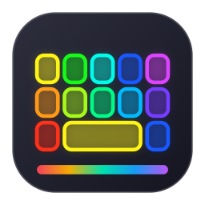
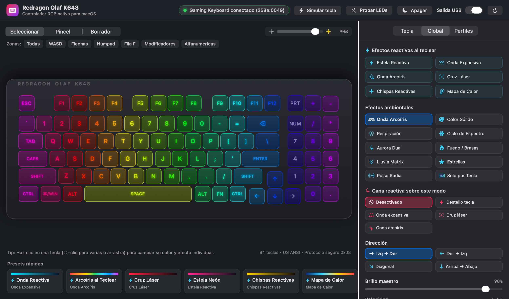
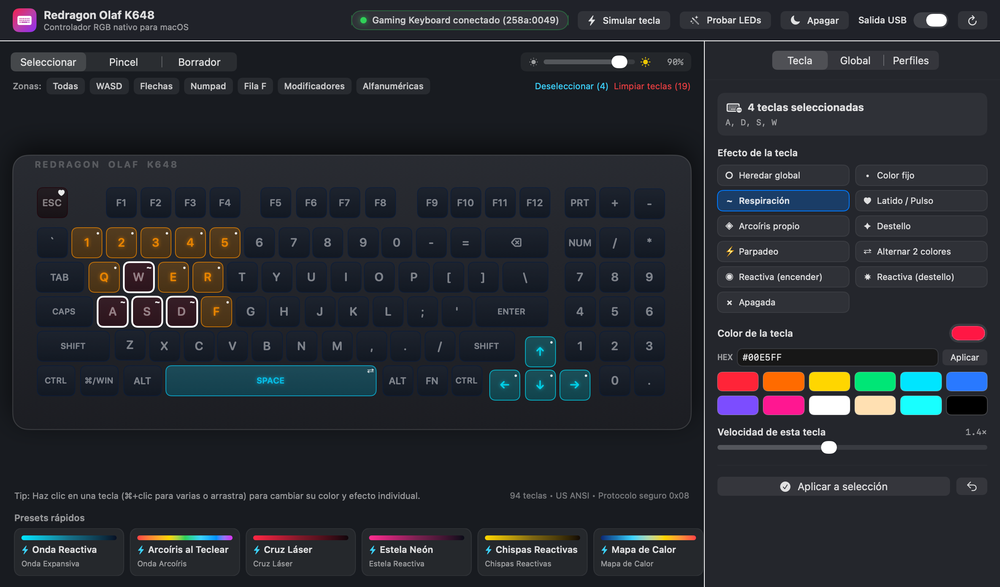
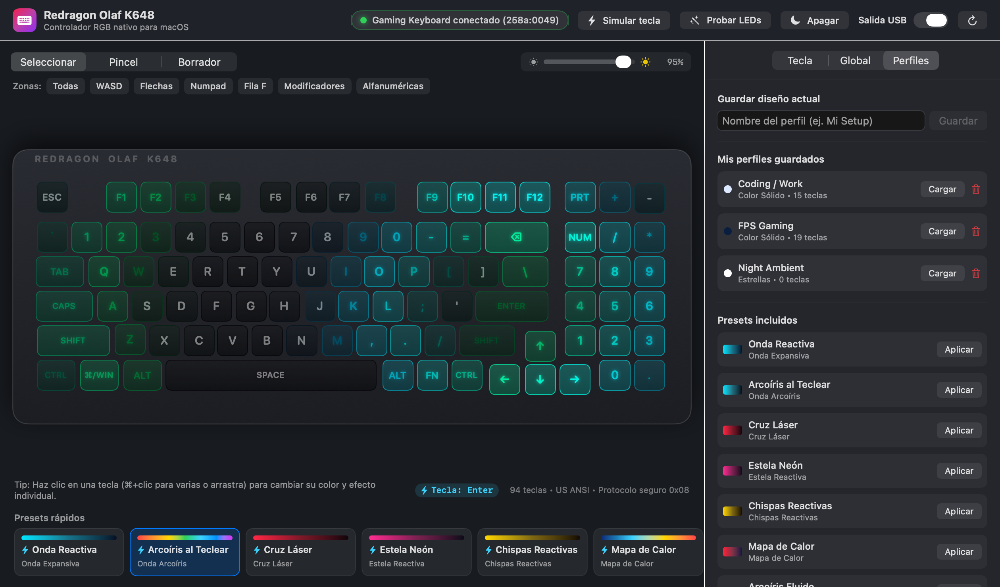

<div align="center">



# Redragon Olaf RGB

**Native macOS RGB Studio for the Redragon K648GG-RGB (Olaf) Mechanical Keyboard**

Control per-key lighting, ambient animations, and 45 FPS real-time reactive effects directly over USB HID — built with SwiftUI, AppKit, and IOKit with zero third-party dependencies, no Windows VM, and no kernel drivers.

[-000000?style=flat-square&logo=apple&logoColor=white)](https://www.apple.com/macos/)
[](https://swift.org/)
[](#requirements)
[](#usb-hid-protocol--safety)
[](#usb-hid-protocol--safety)

<br />



[Features](#features) · [Screenshots](#screenshots) · [USB Safety](#usb-hid-protocol--safety) · [Installation](#build--installation) · [Architecture](#project-architecture)

</div>

---

## Overview

**Redragon Olaf RGB** brings full-featured, native RGB control for the wired **Redragon K648GG-RGB (Olaf)** (`0x258A:0x0049`, Sinowealth MCU) to macOS. Instead of relying on Windows-only vendor utilities or risky firmware writes, it communicates directly with the keyboard's volatile RAM buffer via Apple's IOKit HID API for smooth, real-time lighting control.

---

## Screenshots

### Per-Key Lighting Studio
Select individual keys (`⌘+Click`, click-and-drag, or one-click zone presets like *WASD*, *Arrows*, *Numpad*, and *F-Row*), paint with the brush tool, and assign independent animations, speeds, and `#HEX` colors to every key.



### Real-Time Reactive Effects & Profile Manager
Drive 45 FPS reactive waves, trails, laser crosses, sparks, and heatmaps from your live keystrokes, and manage custom saved profiles alongside 14 built-in presets.



---

## Features

### Interactive 94-Key Canvas
- **Accurate US ANSI K648 Layout:** Physical key geometry and hardware LED slot mappings (`0..101`) with a live real-time preview.
- **Fast Editing Tools:** Switch seamlessly between **Select** (click, `⌘+Click`, marquee/drag, and quick zone selectors), **Brush**, and **Eraser**.

### Per-Key Lighting Control
- **11 Per-Key Modes:** *Inherit Global*, *Solid Color*, *Breathing*, *Heartbeat / Pulse*, *Independent Rainbow*, *Sparkle*, *Blink*, *Dual-Color Fade*, *Reactive (Light Up)*, *Reactive (Flash)*, and *Off*.
- **Fine-Grained Styling:** Native macOS color picker, quick swatches, exact `#HEX` input, and independent animation speed per key.

### 16 Global Effects + Reactive Overlays
| Category | Included Effects |
| :--- | :--- |
| **Ambient (10)** | Rainbow Wave, Solid Color, Breathing, Spectrum Cycle, Dual Aurora, Fire / Embers, Matrix Rain, Starlight Twinkle, Radial Pulse, Per-Key Only |
| **Reactive at 45 FPS (6)** | Reactive Trail, Expanding Ripple, Rainbow Ripple, Laser Cross, Reactive Sparks, Typing Heatmap |
| **Reactive Overlay (4)** | Layer *Key Flash*, *Expanding Ripple*, *Laser Cross*, or *Rainbow Ripple* on top of any ambient effect |

### Built for Daily Use on macOS
- **14 Built-in Presets & Custom Profiles:** Automatically persisted in `~/Library/Application Support/RedragonOlafRGB/` with instant switching from the main window or the menu bar.
- **Dynamic Menu Bar Companion:** Switch saved profiles, launch presets, adjust brightness (`0%`–`100%`), pause USB output, or turn LEDs off right from the macOS menu bar.
- **Background & Dock Options:** Optionally launch hidden in the menu bar and hide the Dock icon when closing the window.
- **Sleep & Screen Lock Auto-Off:** Automatically turns keyboard LEDs off when your Mac locks or sleeps, and restores your active profile on wake.
- **Minimal CPU Footprint:** Automatically pauses USB frame transmission on static profiles and whenever reactive animations settle.

---

## USB HID Protocol & Safety

This application is engineered to communicate **safely** with the Sinowealth MCU (`VID 0x258A`, `PID 0x0049`):

- **Volatile RAM Only (`Report ID 0x08`):** Strictly transmits the 382-byte HID Feature Report `0x08` (4-byte header `08 0A 7A 01` + 126 RGB triples) to HID Interface #1 (`MaxFeatureReportSize >= 382`).
- **Zero Flash or Bootloader Writes:** Never sends `0x05` or `0x06` reports, eliminating any risk of corrupting or bricking keyboard firmware.
- **Non-Exclusive & Privacy-First:** Opens HID interfaces with `kIOHIDOptionsTypeNone` so normal macOS typing is never intercepted or blocked. Keypress events used for reactive effects are processed strictly in memory and are never logged, stored, or transmitted.

---

## Requirements

- **macOS 14.0 (Sonoma)** or later
- **Xcode Command Line Tools** (`swiftc`, `iconutil`, `codesign`) — no full Xcode installation or external dependencies required
- **Redragon K648GG-RGB (Olaf)** connected via USB

> Need to install Xcode Command Line Tools? Run `xcode-select --install`.

---

## Build & Installation

1. **Clone the repository and build the `.app` bundle:**

```bash
git clone https://github.com/holastre/redragon-olaf-rgb.git
cd redragon-olaf-rgb
chmod +x build.sh
./build.sh
```

2. The script compiles the native SwiftUI/IOKit binary, generates `AppIcon.icns`, and produces an ad-hoc signed **`Redragon Olaf RGB.app`** in the repository root.
3. Move **`Redragon Olaf RGB.app`** into your `/Applications` folder and launch it.

### Granting macOS Input Monitoring Permission

macOS requires explicit permission to open the keyboard's HID interface and observe keystrokes for real-time reactive lighting:

1. On first launch, click **Request Permission** in the banner (or open **System Settings → Privacy & Security → Input Monitoring**).
2. Toggle **Redragon Olaf RGB** **ON**.
3. Relaunch the app. The status badge in the top bar will turn green (`Gaming Keyboard conectado (258a:0049)`).

> [!NOTE]
> **Rebuilding from source:** Because `build.sh` uses ad-hoc code signing, each rebuild changes the binary's `cdhash`. If macOS prompts for Input Monitoring permission again after rebuilding, remove the previous entry with **`–`** in *Input Monitoring*, add the newly built app with **`+`**, and relaunch.

---

## Project Architecture

```text
redragon-olaf-rgb/
├── build.sh                     # Compiles the SwiftUI/IOKit binary, builds AppIcon.icns, and ad-hoc signs the bundle
├── docs/
│   ├── assets/
│   │   └── app-icon.png         # App icon asset for documentation
│   └── screenshots/             # High-resolution UI screenshots
├── Resources/
│   ├── Info.plist               # macOS bundle metadata and HID usage description
│   └── make_icon.swift          # Programmatic CoreGraphics generator for AppIcon.icns
└── Sources/
    ├── AppMain.swift            # AppDelegate, main window, dynamic menu bar item, and sleep/lock observers
    ├── ContentView.swift        # SwiftUI interface, interactive 94-key canvas, and inspector sidebar
    ├── HIDController.swift      # Safe USB HID communication (Report 0x08) and non-seized keypress listener
    ├── K648Layout.swift         # 94-key US ANSI physical coordinates, LED slots, and USB HID usage table
    ├── RGBEngine.swift          # 45 FPS effects engine, LiveFrameStore, and Application Support persistence
    └── RGBModels.swift          # Color/gamma math, global & per-key effect models, built-in presets, and profiles
```

---

## Troubleshooting

- **Keyboard shows as disconnected:** Verify the Redragon K648GG-RGB is connected in wired USB mode and check System Information (`USB`) for `Vendor ID: 0x258a` / `Product ID: 0x0049`. Click the refresh icon (`↻`) in the top-right corner to force a reconnect.
- **Permission banner remains after enabling Input Monitoring:** Quit the app completely (from the menu bar → quit) and reopen it. If you recently rebuilt the app, remove and re-add it in **System Settings → Privacy & Security → Input Monitoring**.
- **UI language note:** The current application interface is localized in Spanish; contributions for English localization (`Localizable.xcstrings`) are welcome.
